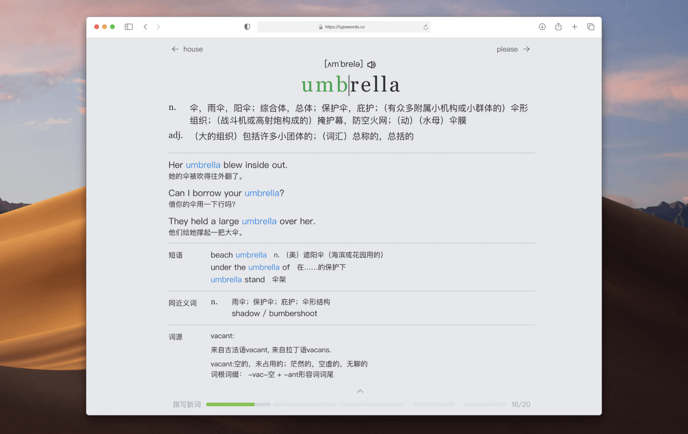

<h1 align=center>
  
</h1>

  <a href="/README.md">English</a> |
  <a href="/docs/README.es.md">Español</a> |
  <a href="/docs/README.de.md">Deutsch</a> |
  <a href="/docs/README.fr.md">Français</a> |
  <a href="/docs/README.pt.md">Português</a> |
  <a href="/docs/README.ru.md">Русский</a> |
  <a href="/docs/README.uk.md">Українська</a> |
  <a href="/docs/README.ja.md">日本語</a> |
  <a href="/docs/README.ko.md">한국인</a> |
  <a href="/docs/README.th.md">ไทย</a> |
  <a href="/docs/README.vi.md">Tiếng Việt</a> |
  <a href="/docs/README.id.md">Bahasa Indonesia</a> |
  <a href="/docs/README.zh-TW.md">繁體中文</a> |
  <a href="/docs/README.zh-CN.md">简体中文</a> 

  <b>Learn English, one keystroke at a time; smarter memorization, more efficient learning - an open-source word and article practice tool</b>

## 从零基础到座舱 TPM 英语

[打开词库和学习指南](https://qiantao18817568425-art.github.io/TypeWords/dict-list/)

此版本基于 [zyronon/TypeWords](https://github.com/zyronon/TypeWords)，保留项目许可证和署名。
学习路线共 27 本词库、4,774 条练习。其中 3,394 条为通用与商务词频词汇，1,380 条场景练习带双语例句。频率词册提供中文释义、可用的音标和词形。

每天先复习，再学少量新词，最后做一次口头或书面输出。打开词库页的「学习指南」查看各阶段的练习任务。

| 阶段 | 条目 | 练完后尝试做的事 |
| --- | ---: | --- |
| 基础入门 | 445 | 用简单句做自我介绍，能问时间、地点和价格。 |
| 生活会话 | 990 | 练一次预约、问路、购物或改行程，能表达需求并复述关键细节。 |
| 通用阅读拓展 | 1,647 | 读一段简短英语，圈出陌生词，试着用一句话复述主旨。可以和职场阶段并行。 |
| 职场沟通 | 910 | 写一封简短确认邮件，把事项、负责人和时间说清楚。 |
| TPM 项目与交付 | 412 | 用英文汇报里程碑、风险、依赖和请求决策的事项。 |
| 座舱技术与实战 | 370 | 说明故障现象、影响、证据、当前假设、责任人和关闭条件。 |

| 词库 | 条目 | 内容 |
| --- | ---: | --- |
| 01 零基础核心 | 120 | 人称、数字、时间、常用动作和最基本的问句。 |
| 02 高频句型与搭配 | 70 | 练常用动词搭配、连接方式和可以替换关键词的句型。 |
| 03 通用高频词 1 | 255 | NGSL 词频第 1 至 350 位，熟悉日常句子里最常见的词。 |
| 04 生活场景词汇 | 108 | 家庭、饮食、交通、购物、天气和健康。 |
| 05 日常英语对话 | 70 | 问候、点餐、出行、预约和礼貌求助。 |
| 06 生活办事与旅行 | 70 | 住房、公共服务、付款、看诊、售后和行程变动。 |
| 07 通用高频词 2 | 371 | NGSL 词频第 351 至 750 位，扩大常用词汇。 |
| 08 通用高频词 3 | 371 | NGSL 词频第 751 至 1150 位，支持日常阅读和描述。 |
| 09 通用高频词 4 | 383 | NGSL 词频第 1151 至 1550 位，练一般说明和阅读。 |
| 10 通用高频词 5 | 385 | NGSL 词频第 1551 至 1950 位，补常用抽象词与书面词。 |
| 11 通用高频词 6 | 388 | NGSL 词频第 1951 至 2350 位，补新闻、邮件和叙述常用词。 |
| 12 通用高频词 7 | 491 | NGSL 余下词频段，并补充星期、月份和数字等无频次排序的词。 |
| 13 工作英语沟通 | 90 | 邮件、会议、澄清问题、协调排期和确认文件。 |
| 14 会议、写作与协商 | 70 | 主持和参与会议、解释观点、表达不同意见和跟进行动项。 |
| 15 商务阅读词汇 1 | 250 | BSL 高频词精选，练商务邮件和工作文档中常见的表达。 |
| 16 商务阅读词汇 2 | 250 | 继续练商务词汇，读懂常见运营、组织和合同相关用词。 |
| 17 商务阅读词汇 3 | 250 | 补充报告、管理和商业阅读中的词汇。 |
| 18 座舱 TPM 入门 | 86 | 项目推进、缺陷分诊、责任分配、协作和验收。 |
| 19 TPM 项目与交付 | 110 | 需求、排期、供应商、风险、测试和版本管理。 |
| 20 供应商、客户与决策 | 72 | 练需求澄清、责任边界、交付承诺、决策和升级。 |
| 21 项目执行与版本管理 | 72 | 练项目节奏、配置基线、集成、发布、风险和变更。 |
| 22 验证、质量与问题闭环 | 72 | 练测试、质量门槛、根因、5 Why、8D 和验证结论。 |
| 23 座舱技术与诊断 | 125 | 座舱系统、软硬件接口、故障现象和取证动作。 |
| 24 座舱平台与人机交互 | 65 | 启动、休眠、显示、输入、相机、音频和平台运行。 |
| 25 车载通信、网络与外设 | 65 | 车载信号、跨域通信、以太网、USB、蓝牙和 Wi-Fi。 |
| 26 故障排查、取证与实车验证 | 65 | 练现象描述、复现、日志与追踪、台架验证和恢复。 |
| 27 TPM 闭环与英文汇报 | 50 | 把术语用到汇报里，练习说清影响、证据、责任、风险和下一步。 |

学习记录保存在当前浏览器。换电脑时可通过设置导出和导入。

公开词表与释义的出处及许可见 [词表来源与授权](public/word-sources/NOTICE.txt)。

用 Node.js 24 和 pnpm 安装锁定依赖后，设置环境变量 NUXT_APP_BASE_URL=/TypeWords/ 和 NITRO_PRESET=github-pages，执行 pnpm run generate。将 .output/public 发布到 GitHub Pages。

## Project Introduction

<https://www.bilibili.com/video/BV1QwYv6eEAS>

## Online Access

<https://typewords.cc>

## Features

### Word Practice

- Practice modes: Follow-along / Dictation / Self-test / Spelling from memory
- Smart mode: Automatically calculates learning words based on memory curves, deepening memory through dictation
- Free mode: No restrictions, plan your own learning
- Provides phonetics, pronunciation (American/British), example sentences, phrases, synonyms, root words, etymology, error statistics, and more

### Article Memorization

- Built-in classic textbooks; you can also add or import articles with one-click translation and bilingual comparison
- Follow-along + dictation dual modes, sentence-by-sentence input with automatic pronunciation for more efficient memorization
- Supports listening while writing from memory to reinforce learning

### Favorites, Wrong Words, Mastered

- Words typed incorrectly while learning are automatically added to your wrong word book for later review
- Actively add words to mastered to automatically skip them in future sessions
- Add words to favorites for consolidation and review

### Highly Customizable

- Rich keyboard sound effects
- Customizable shortcuts
- Highly configurable settings

### Clean and Efficient

- Clean design, modern UI, ad-free
- Refreshing interface, simple operation
- No forced subscription to any platform

### Vocabulary Library

Built-in commonly used vocabulary including CET-4, CET-6, GMAT, GRE, IELTS, SAT, TOEFL, Graduate English, TEM-4, TEM-8, and more (official website only).
Designed to meet most users' vocabulary learning needs. Community contributions of additional vocabulary are welcome.

## Running the Project

#### Note: This project can run standalone with data saved locally. Manual backup is required when switching devices; this does not affect normal usage.

This project is built with `Nuxt` and requires a Node.js environment.

1. Install NodeJS, refer to the [official documentation](https://nodejs.org/en/download)
2. The project is large. It's recommended to use `git clone --depth 1 https://github.com/zyronon/TypeWords.git` to clone only the latest commit. GitHub's Download ZIP feature will not work properly.
3. In the project root directory, open a terminal and run `pnpm install` to download dependencies.
4. Run `pnpm run dev` to start the project. The default address is [`http://localhost:5567`](http://localhost:5567)
5. Open [`http://localhost:5567`](http://localhost:5567) in your browser to access the project.
6. Run `pnpm run generate` to build the project files.

## Features and Suggestions

The project is currently in early development, with new features being added continuously. If you have any suggestions or feature requests, feel free to open an `Issue`.
If you like the design philosophy of this software, please submit a `PR`. Thank you for your support!

## Contributing Guide

[Contributing Guidelines](/docs/CONTRIBUTING.md)

If you're interested in this project, we welcome your contributions and will provide as much help as possible.

Before contributing, please communicate with the developers to avoid code conflicts.

Thank you again for your contributions!

## ❤️ Support TypeWords
If TypeWords has been helpful to you, feel free to sponsor the project to support server operation and future development.  
Of course, sponsorship is not required for use—sharing the project, submitting feedback, or contributing code are also highly valuable forms of support.

